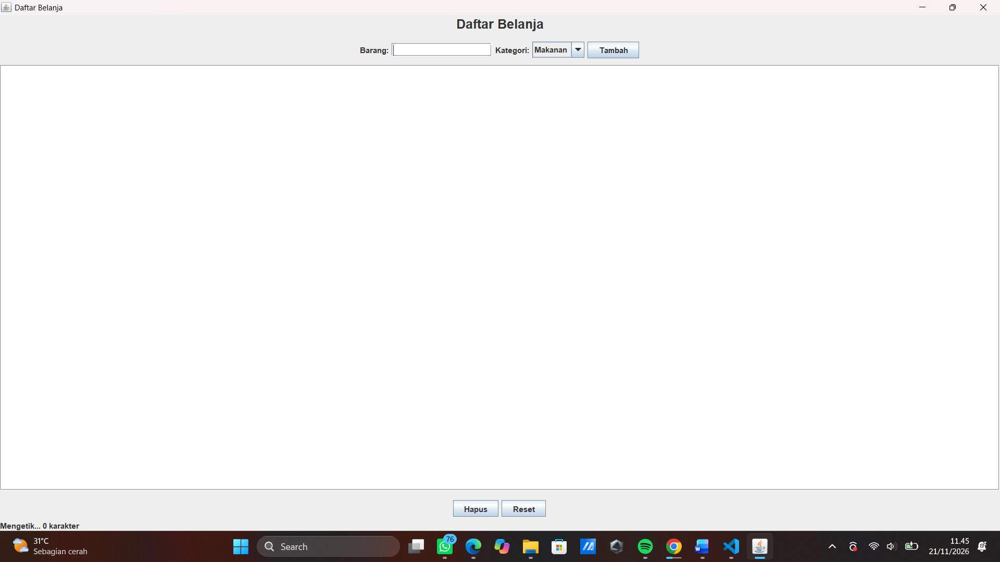
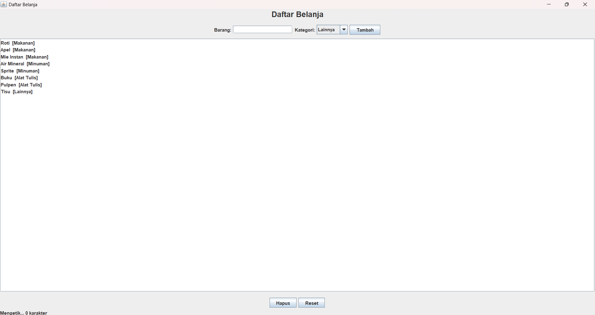

# Daftar Belanja (Java Swing)

Aplikasi GUI sederhana untuk mencatat daftar belanja, dibuat dengan **Java Swing**
sebagai latihan/eksplorasi materi *Graphical User Interface* dan *Event Handling*
pada mata kuliah Pemrograman Berorientasi Objek.

## Fitur

- Menambah barang beserta kategorinya (Makanan, Minuman, Alat Tulis, Lainnya)
- Menekan **Enter** di kolom input juga menambah barang
- Menghapus barang yang dipilih dan mengosongkan seluruh daftar (Reset)
- Validasi input kosong
- Status bar yang menampilkan jumlah barang dan petunjuk tombol
- Konfirmasi saat jendela ditutup

## Screenshot Aplikasi

| Tampilan awal | Setelah menambah barang |
|---|---|
|  |  |

## Ringkasan 5 Komponen Utama

| No | Kategori | Class / Interface yang dipakai |
|----|----------|--------------------------------|
| 1 | Top-level Container Class | `JFrame` |
| 2 | Intermediate Container Class | `JPanel`, `JScrollPane` |
| 3 | Atomic Component Class | `JLabel`, `JTextField`, `JComboBox`, `JButton`, `JList` |
| 4 | Layout Classes | `BorderLayout`, `FlowLayout` |
| 5 | Event Listener | `ActionListener` (interface), `KeyAdapter`, `MouseAdapter`, `WindowAdapter` (class adapter) |

Seluruh kode ada di [`src/DaftarBelanja.java`](src/DaftarBelanja.java). Nomor baris pada
penjelasan di bawah merujuk ke file tersebut.

---

## 1. Top-level Container Class: `JFrame`

`JFrame` adalah wadah paling luar yang berdiri sendiri, yaitu jendela utama aplikasi.
Semua komponen lain diletakkan di dalamnya.

Kode (baris 31, baris 41, dan baris 101–103):

```java
// Deklarasi atribut (baris 31)
private JFrame frame;

// Dibuat di constructor (baris 41)
frame = new JFrame("Daftar Belanja");

// Diatur ukuran & ditampilkan di launchFrame() (baris 101–103)
frame.setSize(520, 380);
frame.setLocationRelativeTo(null);
frame.setVisible(true);
```

---

## 2. Intermediate Container Class: `JPanel` dan `JScrollPane`

Wadah di dalam `JFrame` yang dipakai untuk mengelompokkan komponen. Aplikasi ini memakai
4 `JPanel` (`panelForm`, `panelTengah`, `panelTombol`, `panelBawah`) dan 1 `JScrollPane`
yang membungkus `JList` agar daftar dapat di-scroll.

Kode (baris 63–82):

```java
JPanel panelForm = new JPanel(new FlowLayout());
panelForm.add(new JLabel("Barang:"));
panelForm.add(fieldBarang);
panelForm.add(new JLabel("Kategori:"));
panelForm.add(comboKategori);
panelForm.add(btnTambah);

JPanel panelTengah = new JPanel(new BorderLayout(5, 5));
panelTengah.add(panelForm, BorderLayout.NORTH);
panelTengah.add(new JScrollPane(listBarang), BorderLayout.CENTER);
frame.add(panelTengah, BorderLayout.CENTER);

// Panel bawah: tombol + status
JPanel panelBawah = new JPanel(new BorderLayout());
JPanel panelTombol = new JPanel(new FlowLayout());
panelTombol.add(btnHapus);
panelTombol.add(btnReset);
panelBawah.add(panelTombol, BorderLayout.NORTH);
panelBawah.add(lblStatus, BorderLayout.SOUTH);
frame.add(panelBawah, BorderLayout.SOUTH);
```

---

## 3. Atomic Component Class: `JLabel`, `JTextField`, `JComboBox`, `JButton`, `JList`

Komponen terkecil yang berinteraksi langsung dengan pengguna dan tidak berisi komponen lain.

| Komponen | Fungsi |
|---|---|
| `JLabel` | Judul, label "Barang:" dan "Kategori:", serta status |
| `JTextField` | Input nama barang |
| `JComboBox` | Pilihan kategori |
| `JButton` | Tombol Tambah, Hapus, dan Reset |
| `JList` | Menampilkan daftar belanja (datanya disimpan di `DefaultListModel`) |

Kode (baris 31–37 dan baris 40–51):

```java
// Deklarasi komponen (baris 31–37)
private JFrame frame;
private JTextField fieldBarang;
private JComboBox<String> comboKategori;
private JButton btnTambah, btnHapus, btnReset;
private JList<String> listBarang;
private DefaultListModel<String> model;
private JLabel lblStatus;

// Pembuatan objek di constructor (baris 40–51)
public DaftarBelanja() {
    frame = new JFrame("Daftar Belanja");
    fieldBarang = new JTextField(15);
    comboKategori = new JComboBox<String>(
            new String[] { "Makanan", "Minuman", "Alat Tulis", "Lainnya" });
    btnTambah = new JButton("Tambah");
    btnHapus = new JButton("Hapus");
    btnReset = new JButton("Reset");
    model = new DefaultListModel<String>();
    listBarang = new JList<String>(model);
    lblStatus = new JLabel("Siap. Total barang: 0");
}
```


---

## 4. Layout Classes: `BorderLayout` dan `FlowLayout`

| Layout | Dipakai pada |
|---|---|
| `BorderLayout` | `JFrame` (judul di NORTH, panel tengah di CENTER, panel bawah di SOUTH), panel tengah, dan panel bawah |
| `FlowLayout` | Panel form input dan panel tombol (komponen berjajar ke samping) |

Kode (baris 55, baris 60, baris 63, baris 70–73, dan baris 76–82):

```java
// BorderLayout pada JFrame (baris 55), judul di NORTH (baris 60)
frame.setLayout(new BorderLayout(10, 10));
frame.add(judul, BorderLayout.NORTH);

// FlowLayout pada panel form (baris 63)
JPanel panelForm = new JPanel(new FlowLayout());

// BorderLayout pada panel tengah (baris 70–73)
JPanel panelTengah = new JPanel(new BorderLayout(5, 5));
panelTengah.add(panelForm, BorderLayout.NORTH);
panelTengah.add(new JScrollPane(listBarang), BorderLayout.CENTER);
frame.add(panelTengah, BorderLayout.CENTER);

// BorderLayout (panel bawah) & FlowLayout (panel tombol) (baris 76–82)
JPanel panelBawah = new JPanel(new BorderLayout());
JPanel panelTombol = new JPanel(new FlowLayout());
panelTombol.add(btnHapus);
panelTombol.add(btnReset);
panelBawah.add(panelTombol, BorderLayout.NORTH);
panelBawah.add(lblStatus, BorderLayout.SOUTH);
frame.add(panelBawah, BorderLayout.SOUTH);
```


---

## 5. Event Listener

Seluruh handler dibuat sebagai **inner class** sehingga dapat langsung mengakses komponen
GUI milik class luar. Method listener di-*override* (`@Override`) dari **interface**
(`ActionListener`) atau dari **class adapter** (`KeyAdapter`, `MouseAdapter`, `WindowAdapter`).

| Handler | Tipe | Method yang di-override | Fungsi |
|---|---|---|---|
| `TambahHandler` | implements `ActionListener` (interface) | `actionPerformed` | Menambah barang (klik Tambah / Enter) |
| `HapusHandler` | implements `ActionListener` (interface) | `actionPerformed` | Menghapus barang terpilih |
| `ResetHandler` | implements `ActionListener` (interface) | `actionPerformed` | Mengosongkan daftar |
| `KetikHandler` | extends `KeyAdapter` (abstract class) | `keyReleased` | Menampilkan jumlah karakter yang diketik |
| `HoverHandler` | extends `MouseAdapter` (abstract class) | `mouseEntered`, `mouseExited` | Mengubah status saat mouse di atas tombol |
| `TutupHandler` | extends `WindowAdapter` (abstract class) | `windowClosing` | Konfirmasi sebelum keluar |

`ActionListener` hanya punya satu method sehingga langsung di-`implements`. Listener lain
punya banyak method, jadi dipakai class adapter agar cukup meng-override method yang dibutuhkan.

### a. Registrasi listener ke komponen (baris 84–99)

Listener harus didaftarkan ke komponen (event source) agar dipanggil ketika event terjadi.

```java
// --- Registrasi listener ke event source ---
TambahHandler tambah = new TambahHandler();
btnTambah.addActionListener(tambah);
fieldBarang.addActionListener(tambah);          // tekan Enter = Tambah
btnHapus.addActionListener(new HapusHandler());
btnReset.addActionListener(new ResetHandler());

fieldBarang.addKeyListener(new KetikHandler());

HoverHandler hover = new HoverHandler();
btnTambah.addMouseListener(hover);
btnHapus.addMouseListener(hover);
btnReset.addMouseListener(hover);

frame.setDefaultCloseOperation(JFrame.DO_NOTHING_ON_CLOSE);
frame.addWindowListener(new TutupHandler());
```

### b. `ActionListener` (baris 112–128)

Contoh `TambahHandler`. `HapusHandler` ada di baris 130–143 dan `ResetHandler` di baris 145–153.

```java
// ActionListener: tombol Tambah / Enter
private class TambahHandler implements ActionListener {
    @Override
    public void actionPerformed(ActionEvent e) {
        String barang = fieldBarang.getText().trim();
        if (barang.isEmpty()) {
            JOptionPane.showMessageDialog(frame, "Nama barang tidak boleh kosong!",
                    "Peringatan", JOptionPane.WARNING_MESSAGE);
            return;
        }
        String kategori = (String) comboKategori.getSelectedItem();
        model.addElement(barang + "  [" + kategori + "]");
        fieldBarang.setText("");
        fieldBarang.requestFocus();
        updateStatus();
    }
}
```

### c. `KeyAdapter` (baris 155–161)

```java
// KeyAdapter: hanya override method yang dipakai (keyReleased)
private class KetikHandler extends KeyAdapter {
    @Override
    public void keyReleased(KeyEvent e) {
        lblStatus.setText("Mengetik... " + fieldBarang.getText().length() + " karakter");
    }
}
```

### d. `MouseAdapter` (baris 163–175)

```java
// MouseAdapter: hanya override mouseEntered & mouseExited
private class HoverHandler extends MouseAdapter {
    @Override
    public void mouseEntered(MouseEvent e) {
        JButton b = (JButton) e.getSource();
        lblStatus.setText("Klik untuk: " + b.getText());
    }

    @Override
    public void mouseExited(MouseEvent e) {
        updateStatus();
    }
}
```

### e. `WindowAdapter` (baris 177–187)

```java
// WindowAdapter: hanya override windowClosing
private class TutupHandler extends WindowAdapter {
    @Override
    public void windowClosing(WindowEvent e) {
        int pilih = JOptionPane.showConfirmDialog(frame, "Yakin ingin keluar?",
                "Konfirmasi", JOptionPane.YES_NO_OPTION);
        if (pilih == JOptionPane.YES_OPTION) {
            System.exit(0);
        }
    }
}
```

Contoh hasil event: saat mouse masuk ke tombol **Tambah**, `HoverHandler` mengubah teks status.


---

## Struktur Proyek

```
DaftarBelanja-GUI/
├── src/
│   └── DaftarBelanja.java
├── screenshots/
│   ├── 01-tampilan-awal.png
│   ├── 02-setelah-tambah-barang.png
│   ├── 03-top-level-container.png
│   ├── 04-intermediate-container.png
│   ├── 05-atomic-component.png
│   ├── 06-layout.png
│   └── 07-event-listener.png
└── README.md
```

## Cara Menjalankan

Prasyarat: **JDK 8 atau lebih baru**.

```bash
cd src
javac DaftarBelanja.java
java DaftarBelanja
```
